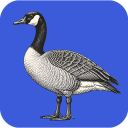

<p align="center">
  
</p>

<h1 align="center">WordCraft</h1>

<p align="center">
  <b>An open-source word processor, written in Rust.</b>
</p>

<p align="center">
  A fast word processor with a familiar workflow: the ribbon, styles, tables, track changes,
  references and mail merge. It reads and writes .docx, runs natively on macOS, Windows, Linux
  and BSD, and runs in the browser via WebAssembly.
</p>

<p align="center">
  <sub>By the <a href="https://getartcraft.com/">ArtCraft</a> team.</sub>
</p>

<p align="center">
  <a href="https://github.com/storytold/wordcraft/releases/latest"></a>
  <a href="https://github.com/storytold/wordcraft/releases"></a>
  <!-- TODO: add a CI status badge once the workflow file name is confirmed -->
  
  
  
  
</p>

<p align="center">
  <a href="#download">Download</a> ·
  <a href="#a-tour">Tour</a> ·
  <a href="#why-wordcraft">Why WordCraft</a> ·
  <a href="#what-works-today">What works today</a> ·
  <a href="#quick-start">Build from source</a> ·
  <a href="#for-agents-cli-and-mcp">For agents</a> ·
  <a href="#architecture">Architecture</a> ·
  <a href="#roadmap">Roadmap</a> ·
  <a href="#contributing">Contributing</a> ·
  <a href="#the-crafting-apps">Crafting Apps</a> ·
  <a href="#license-and-credits">License</a>
</p>

> [!WARNING]
> WordCraft is **alpha software**. Keep backups of important documents, and check round trips
> of complex .docx files: charts and SmartArt are not preserved yet. See the
> [Roadmap](#roadmap) for what is and isn't ready.

<p align="center">
  
  <br><sub><b>The Open Studio Handbook</b>, WordCraft's built-in sample: the ribbon, live Styles gallery, rulers and the Navigation pane.</sub>
</p>

## Download

Grab the build for your system from the [latest release](https://github.com/storytold/wordcraft/releases/latest):

| System | Get this file |
|---|---|
| Windows | `wordcraft-<ver>-windows-x64.msi` (or `-portable.zip`) |
| macOS | `wordcraft-<ver>-macos-universal.dmg` |
| Linux | `wordcraft-<ver>-linux-x86_64.AppImage` (also `.deb`, `.rpm`, Flatpak, tarball) |
| Browser | `wordcraft-web-<ver>.zip`, hosted on any static server |

`<ver>` is the version number. All platforms, ARM builds, FreeBSD, checksum verification and
community packages (AUR, Gentoo) are in **[docs/install.md](docs/install.md)**. If the app
won't start or looks wrong, see **[docs/troubleshooting.md](docs/troubleshooting.md)**.

## A tour

Every screenshot below is WordCraft itself, rendered offscreen by its own UI test harness
(`cargo run -p wordcraft-ui-egui --example ui_shot`).

<table>
<tr>
<td width="50%" valign="top"><p align="center"><sub><b>Review.</b> Track changes, comment balloons in the margin, accept and reject, spelling and grammar as you type. Insertions are magenta and deletions struck through, with dashed leader lines to each comment.</sub></p></td>
<td width="50%" valign="top"><p align="center"><sub><b>References.</b> Tables of contents, footnotes, citations in APA, MLA, Chicago or IEEE, index and captions.</sub></p></td>
</tr>
<tr>
<td width="50%" valign="top"><p align="center"><sub><b>Design.</b> Themes, style sets, paragraph spacing, watermarks, page color and borders.</sub></p></td>
<td width="50%" valign="top"><p align="center"><sub><b>Dark mode</b> with formatting marks, and the Insert tab: tables, pictures, shapes, links, headers, footers, fields and symbols.</sub></p></td>
</tr>
<tr>
<td colspan="2"><p align="center"><sub><b>Layout.</b> Drop caps, text wrapping around pictures and shapes, automatic hyphenation, line numbers and page borders.</sub></p></td>
</tr>
<tr>
<td colspan="2"><p align="center"><sub><b>File.</b> Start from a template, open recent documents, edit properties, export to PDF and other formats.</sub></p></td>
</tr>
</table>

## Why WordCraft

- **Familiar.** Ribbon tabs, groups, shortcuts and behavior: Enter continues a list,
  Tab demotes it, Ctrl/⌘+B bolds the word under the caret, the Styles gallery previews styles live,
  F4 repeats, F7 checks spelling, F8 extends the selection.
- **Your files.** Opens and saves .docx (OOXML), and also .odt, .rtf, .html, .md, .tex (LaTeX), .txt;
  opens legacy 97-2003 .doc; exports PDF with real, selectable text, links and bookmarks.
- **Fast.** Paragraph layout is cached, so typing in a 188-page document re-lays it out in about
  1.4 ms; pages render on demand.
  <!-- TODO: state hardware and method, or link docs/benchmarks.md -->
- **Everywhere.** One Rust codebase for macOS, Windows, Linux, BSD and the web. No Electron, no
  Tauri: native [egui](https://github.com/emilk/egui) on the GPU.
- **Built for agents.** Every action is a command with an id. The same 422 commands drive the
  ribbon, keyboard shortcuts, the command search, a command-line tool, a JSON control channel and
  an MCP server. <!-- TODO: generate the command count in CI so it can't go stale -->
- **Private.** Spelling, grammar and everything else work offline, and document text is never
  logged. <!-- TODO: confirm and add "no telemetry" if true -->
- **Open.** MIT OR Apache-2.0. Clean-room: built from public specifications and black-box
  observation of file-format behavior, with every asset original or openly licensed.
  <!-- TODO: confirm this wording of "observation" is accurate -->

## What works today

| Area | Highlights |
|---|---|
| **Writing** | Fast typing with IME, smart quotes, AutoCorrect, list autoformat (`* `, `1. `), dashes; word, sentence, paragraph selection; drag-select; clipboard with formatting; undo/redo; find and replace with regex |
| **Formatting** | Fonts, sizes, bold/italic/underline styles, strike, sub/superscript, caps, highlight, colors, character spacing, Format Painter, Change Case, Clear Formatting |
| **Paragraphs** | Alignment, indents (draggable on the ruler), spacing, line spacing, tabs with leaders, borders, shading, keep with next, widow/orphan control |
| **Styles** | Built-in style set, live gallery, Styles pane, create/modify/update styles, style sets, themes |
| **Lists** | Bullets, numbering, multilevel, restart, set value, custom formats |
| **Tables** | Insert by grid, merge/split, styles with banded rows, borders, shading, header rows repeated across pages, rows that split across pages, sort, formulas, text ↔ table |
| **Pages** | Margins, orientation, size, columns, page/column/section breaks, headers and footers (first page, odd/even), page numbers, watermark, page borders, line numbers, vertical alignment, drop caps, automatic hyphenation |
| **Objects** | Pictures (resize, crop, recolor, brightness/contrast, transparency, background removal, picture styles, rotate), shapes, text boxes, floating position with text wrapping (square, top and bottom, behind or in front of text) |
| **References** | Table of contents, footnotes and endnotes, citations and bibliography (APA, MLA, Chicago, IEEE), captions, table of figures, cross-references, index, table of authorities |
| **Review** | Spelling and grammar with suggestions (English and Polish, by each run's language), thesaurus, word count, comments in margin balloons or a pane, track changes, accept/reject, compare documents, restrict editing, accessibility checker, document inspector |
| **Mailings** | Mail merge from CSV, merge fields, address block, greeting line, rules, preview, finish to a document; envelopes and labels |
| **View** | Print layout, web layout, draft, read mode, focus, zoom, one/multiple pages, page width, Navigation pane, rulers, gridlines, dark mode; interface in 28 languages that follow the system language by default ([full list](docs/i18n.md)) |
| **Files** | .docx read/write, legacy 97-2003 .doc import, PDF export, .odt, .rtf, .html, .md, .tex, .txt import/export, page images |

The honest picture, area by area, is in [ROADMAP.md](ROADMAP.md), the
[parity assessment](docs/target-app-parity.md) and the generated
[feature checklist](docs/parity-checklist.md).

## Quick start

To build from source (most people should [download a release](#download) instead):

**Requirements:** a recent stable Rust toolchain, plus the system libraries egui/wgpu need on
Linux. The web build also needs [`trunk`](https://trunkrs.dev/) and the `wasm32-unknown-unknown`
target.
<!-- TODO: state the minimum Rust version (MSRV), the exact Linux packages, and the wasm target setup -->

```sh
git clone https://github.com/storytold/wordcraft
cd wordcraft
cargo run --release -p wordcraft -- --sample        # the desktop app with the sample document
cargo run --release -p wordcraft -- report.docx     # open a document
```

<details>
<summary><b>Building with translations and spelling data (craft-i18n)</b></summary>

The interface translations and the spelling and hyphenation data come from
[craft-i18n](https://github.com/storytold/craft-i18n), an optional build input. To build with them,
check it out at the commit in `craft-i18n.rev` and point `CRAFT_I18N_DIR` at it (an absolute
path); without it WordCraft builds with an English interface, English spelling falls back to an
installed Hunspell English or craft-proof's built-in word list, and only Bulgarian, Turkish and
Russian hyphenate (by rule):

```sh
git clone https://github.com/storytold/craft-i18n ../craft-i18n
git -C ../craft-i18n checkout "$(cat craft-i18n.rev)"
CRAFT_I18N_DIR="$PWD/../craft-i18n" cargo run --release -p wordcraft -- --sample
```

</details>

Command line:

```sh
wordcraft-cli convert report.docx report.pdf        # docx, pdf, odt, rtf, html, md, tex, txt, png
wordcraft-cli text report.docx                      # plain text
wordcraft-cli inspect report.docx                   # structure as JSON
wordcraft-cli run --template sample \
  --cmd 'select.text={"text":"Membership"}' --cmd format.bold --save out.docx
wordcraft-cli run --script job.json                 # the same from a file: commands, then save to docx and pdf
```

Web: `cd apps/wordcraft-web && trunk serve`, then open <http://127.0.0.1:8771/?sample>.

## For agents: CLI and MCP

WordCraft was designed to be driven by people *and* by AI agents.

Add it to any MCP client with this configuration:

```json
{ "mcpServers": { "wordcraft": { "command": "wordcraft-cli", "args": ["mcp"] } } }
```

Or, with Claude Code:

```sh
claude mcp add wordcraft -- wordcraft-cli mcp                  # headless documents
# confine the agent to folders: wordcraft-cli mcp --automation-read-root DIR --automation-write-root DIR
wordcraft --control 7981 &                                     # or drive the running app…
claude mcp add wordcraft-app -- wordcraft-cli mcp --connect 127.0.0.1:7981
```

`--control 7981` opens a control channel that lets a client drive the running app.
<!-- TODO: confirm it binds to localhost only, and state what it can do and any authentication -->

Tools include `list_commands`, `execute`, `batch`, `type_text`, `select_text`, `inspect_document`,
`render_page`, `save_document`, and, with a running app, `screenshot`, `click` and `key`. Agents
can check their work through `inspect_document` without screenshots. See [docs/mcp.md](docs/mcp.md)
and the [control protocol](docs/control-protocol.md). Macros record any sequence of commands and
play it back (`tools.recordMacro`, `tools.macros`).

## Architecture

| Layer | Crate | Job |
|---|---|---|
| L0 | `wordcraft-geom` | units and measurements |
| L1 | `wordcraft-doc`, `wordcraft-fonts`, `wordcraft-proof` ([`craft-proof`](https://github.com/storytold/craft-libs/tree/main/crates/proof) from craft-libs) | document model and editing; fonts and shaping; spelling, grammar, hyphenation (data: craft-i18n `language-data/`, `CRAFT_I18N_DIR`) |
| L2 | `wordcraft-layout`, `wordcraft-docx`, `wordcraft-formats` | line breaking, pagination, tables, notes, hit testing; OOXML; ODT/RTF/HTML/Markdown/TXT |
| L3 | `wordcraft-render`, `wordcraft-pdf` | rasteriser (vello_cpu); PDF ([craft-pdf](docs/shared-pdf.md), Krilla) |
| L4 | `wordcraft-engine` | session, undo, 422 commands, document feature catalog |
| L5 | `wordcraft-mcp` | MCP server |
| L6 | `wordcraft-ui-egui` | the word processor front end (swappable) |
| apps | `wordcraft`, `wordcraft-cli`, `wordcraft-web` | desktop, command line, browser |

`cargo xtask ci` runs formatting, clippy, ~800 tests, the asset-attribution check, the layering
check and the wasm build.

## Roadmap

WordCraft is in **alpha**. It has commands for 97% of the ribbon and menu features in its feature catalog
([`docs/parity-checklist.md`](docs/parity-checklist.md)) today; counting
depth, file fidelity, stability and the rest, we estimate it is about 60% ready for real work,
about 55% for a typical professional's weekly work and about 63% for everyday essentials.
<!-- TODO: link the methodology behind these percentages -->
Beta needs testing against real-world .docx files, keeping charts and SmartArt through a round
trip, closer pagination fidelity, a stability sweep and native printing. Details and estimates:
[ROADMAP.md](ROADMAP.md) and [where we fall short](docs/gaps.md).

## Contributing

Bug reports and pull requests are welcome.

- **Report a bug or request a feature:** [GitHub issues](https://github.com/storytold/wordcraft/issues). Attach `logs/wordcraft.log` to bug reports (see [Logs](docs/troubleshooting.md#logs)).
- **Contribute code:** contributor and agent instructions are in [AGENTS.md](AGENTS.md).
- **Get credited:** add your own entry to `contributors/people.toml` in your pull request; see [Credit yourself](docs/contributors.md#credit-yourself).
- **Report a security issue:** see [SECURITY.md](SECURITY.md).
- **Chat:** the [ArtCraft Discord](https://discord.gg/artcraft).

## The Crafting Apps

WordCraft is one of the **Crafting Apps**: free, open-source creative tools from the
[ArtCraft](https://getartcraft.com/) team, each written from scratch in Rust and each able to
stand on its own. And [**ArtCraft**](https://getartcraft.com/) itself is our AI image and video
studio for artists who want real control.

<details>
<summary><b>See all the Crafting Apps</b></summary>

| | App | What it's for | Code | Learn more |
|:-:|---|---|---|---|
|  | **PhotoCraft** | Image editing: layers, masks, type and real PSD files | [GitHub](https://github.com/storytold/photocraft) | [Website](https://getartcraft.com/apps/photocraft) |
|  | **VectorCraft** | Vector illustration | [GitHub](https://github.com/storytold/vectorcraft) | [Website](https://getartcraft.com/apps/vectorcraft) |
|  | **FilmCraft** | Video editing, color and sound | [GitHub](https://github.com/storytold/filmcraft) | [Website](https://getartcraft.com/apps/filmcraft) |
|  | **LightCraft** | Photo library and raw development | [GitHub](https://github.com/storytold/lightcraft) | [Website](https://getartcraft.com/apps/lightcraft) |
|  | **PdfCraft** | Reading, organizing and protecting PDFs | [GitHub](https://github.com/storytold/pdfcraft) | [Website](https://getartcraft.com/apps/pdfcraft) |
|  | **EffectCraft** | Motion graphics and visual effects | [GitHub](https://github.com/storytold/effectcraft) | [Website](https://getartcraft.com/apps/effectcraft) |
|  | **DesignCraft** | Page layout and publishing | [GitHub](https://github.com/storytold/designcraft) | [Website](https://getartcraft.com/apps/designcraft) |
|  | **FigCraft** | Interface design and prototyping | [GitHub](https://github.com/storytold/figcraft) | [Website](https://getartcraft.com/apps/figcraft) |
|  | **WordCraft** | Word processing and documents | [GitHub](https://github.com/storytold/wordcraft) | [Website](https://getartcraft.com/apps/wordcraft) |
|  | **SoundCraft** | Audio recording and editing | [GitHub](https://github.com/storytold/soundcraft) | [Website](https://getartcraft.com/apps/soundcraft) |
|  | **DeckCraft** | Presentations and slide decks | [GitHub](https://github.com/storytold/deckcraft) | [Website](https://getartcraft.com/apps/deckcraft) |
|  | **CADCraft** | Computer-aided design | [GitHub](https://github.com/storytold/cadcraft) | [Website](https://getartcraft.com/apps/cadcraft) |
|  | **GridCraft** | Spreadsheets and data | [GitHub](https://github.com/storytold/gridcraft) | [Website](https://getartcraft.com/apps/gridcraft) |
|  | **TextureCraft** | 3D texture painting | [GitHub](https://github.com/storytold/texturecraft) | [Website](https://getartcraft.com/apps/texturecraft) |
|  | **Craft Anything** | See how any software works, then build your own | [GitHub](https://github.com/storytold/craft-anything) | [Website](https://getartcraft.com/apps/craft-anything) |
|  | **SolidCraft** | Parametric 3D CAD by Tangency Labs (community app) | [GitHub](https://github.com/tangency-labs/solidcraft) | — |

</details>

## Come make things with us

ArtCraft is a community of artists from all walks of life: painters, photographers, filmmakers,
illustrators, designers, animators, hobbyists, and people who picked up a pencil last week. Our
Discord is where we share what we're working on, ask for help, report what's broken, and say what
we wish these tools could do. Whatever your medium and however long you've been at it, you're welcome.

<p align="center">
  <a href="https://discord.gg/artcraft"></a>
</p>

<p align="center">
  <a href="https://getartcraft.com/">getartcraft.com</a> ·
  <a href="https://getartcraft.com/apps">The Crafting Apps</a> ·
  <a href="https://getartcraft.com/apps/wordcraft">WordCraft</a>
</p>

## License and credits

WordCraft is dual-licensed under [MIT](LICENSE-MIT) or [Apache-2.0](LICENSE-APACHE), at your option.
Copyright (c) 2026 ArtCraft Team and the WordCraft contributors. Required notices are in [NOTICE](NOTICE).

Microsoft and Word are trademarks of Microsoft Corporation. WordCraft is an independent project
and is not affiliated with or endorsed by Microsoft.

Bundled fonts, icons, images and other assets keep their own open licenses; each one is listed
with its author, source and license in [ATTRIBUTION.md](ATTRIBUTION.md).

The English spelling dictionary and hyphenation come from Grady Ward's public-domain Moby
Hyphenator II word list. Polish spelling reads the Hunspell `pl_PL` dictionary installed on the system (not bundled), as
do Russian, Portuguese, Czech, Italian, Croatian and Turkish spelling (how to install them:
[docs/spelling-dictionaries.md](docs/spelling-dictionaries.md)), and
Polish hyphenation the TeX patterns by Hanna Kołodziejska, Bogusław Jackowski and Marek Ryćko (MIT
option). The sample documents and templates are original text written for WordCraft.

The ArtCraft name, wordmark and logos in [`docs/brand/`](docs/brand/) are trademarks of the
ArtCraft Team and are not covered by this license. They may be used only unmodified, and only as
part of this repository and WordCraft, under [`docs/brand/LICENSE-brand.txt`](docs/brand/LICENSE-brand.txt).
Forks and modified versions must remove them.

<p align="center">
  <a href="https://sonarcloud.io/project/overview?id=storytold_wordcraft"></a>
  <a href="https://coderabbit.ai"></a>
</p>

<p align="center">
  <a href="https://getartcraft.com/"><picture>
    <source media="(prefers-color-scheme: dark)" srcset="docs/brand/artcraft-logo-white.svg">
    
  </picture></a><br>
  <sub>Made by the <a href="https://getartcraft.com/">ArtCraft</a> team and community.</sub>
</p>
