# Current paragraph-shading paint

Main `242e850aaad6bf38e1cd2be4122cc7cb9e5a15a8` versus candidate `7e4c68ec8cc472e91ec6306ba7ad0f14da82ec29`, rendered on Linux ARM64 with Rust1.95. Exact OS, checker image, toolchain, source and binary hashes are in [renders.json](renders.json).

Both builds use the identical tracked `crates/render/examples/table_shading.rs` harness, SHA256 `492d9c45401859e514fe19405dd713fb8e7f9d57ed9afbc26c6cc44e3ef737da`. Baseline harness-only commit `e33c75fe9aa4aa2ac75c6e21a04beee06eaa09ea` leaves main production source unchanged. The document model, render options and page scale are identical. Rendered faces resolve to the repository's Source Sans3, verified from actual face bytes, not the requested family alone.

The evidence commit adds only this bundle. Its production source and example remain identical to the recorded candidate build. Historical evidence in the parent directory retains its original binding.

Observed paint:

- Spacing: fill moves with the paragraph instead of remaining below the preceding text.
- Widow: abandoned fill disappears from the old page; the moved paragraph keeps its fill.
- Partial: continuation fill follows each physical line fragment.
- Closing: the same fragment behavior retains the closing rule and cell clearance.
- Cell and equal-colour cases: every PNG is byte-identical between builds.

Page counts match. These are synthetic raster controls, not a new native Word or customer-corpus qualification. No fonts or customer files are included.

To reproduce, create separate checkouts for the main and candidate commits. Copy the candidate's exact example into the main checkout, preserving all other main files. Make that copied example tracked. Use the same font environment and run on each checkout:

```sh
cargo run --locked --offline -p wordcraft-render --example table_shading -- /private/output
```

The example writes actual resolved font binaries into that private output directory. Keep them private. Match their hashes to the repository font listed in the manifest. Compare PNGs by physical page without changing the source model.

| Physical page | Main | Candidate |
|---|---|---|
| cell-1.png |  | 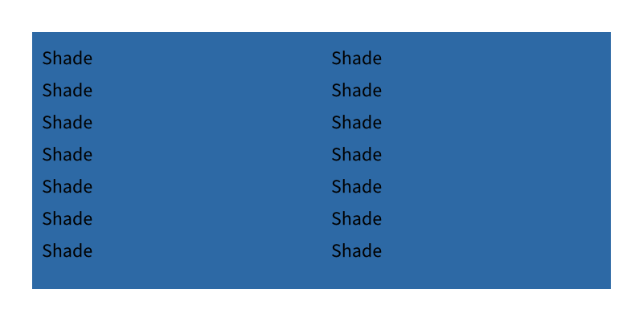 |
| cell-2.png |  |  |
| cell-3.png | 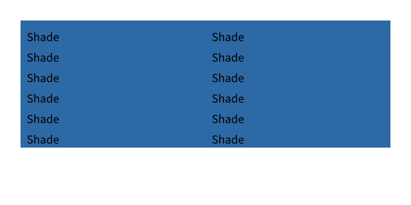 |  |
| closing-1.png | 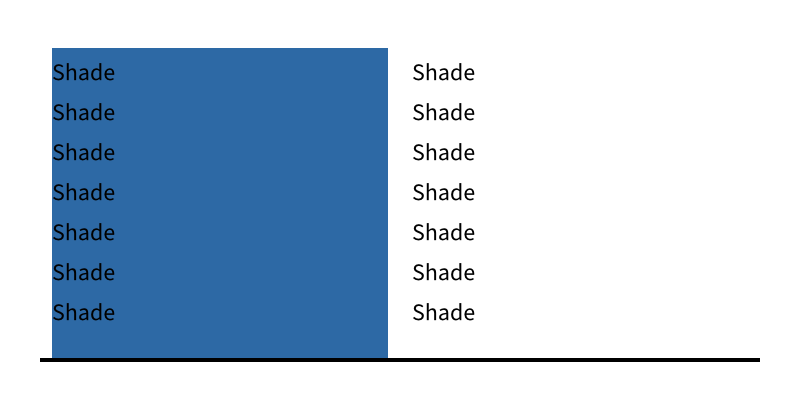 |  |
| closing-2.png | 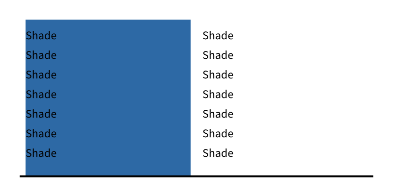 | 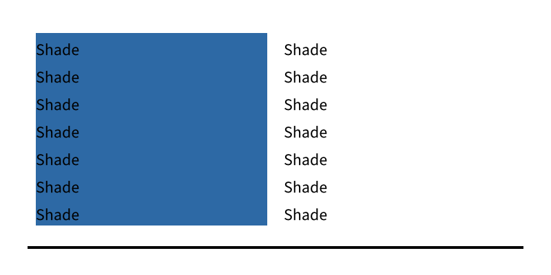 |
| closing-3.png | 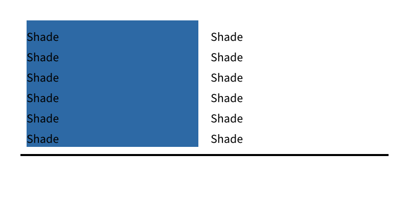 | 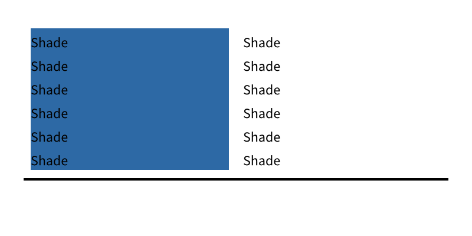 |
| equal-1.png |  |  |
| equal-2.png |  |  |
| equal-3.png |  |  |
| partial-1.png | 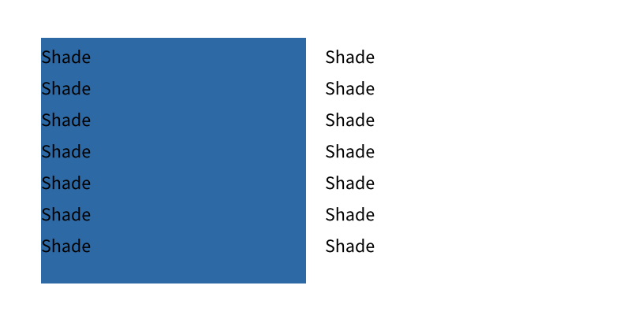 |  |
| partial-2.png | 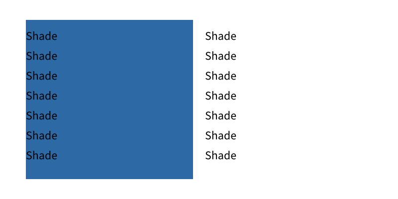 | 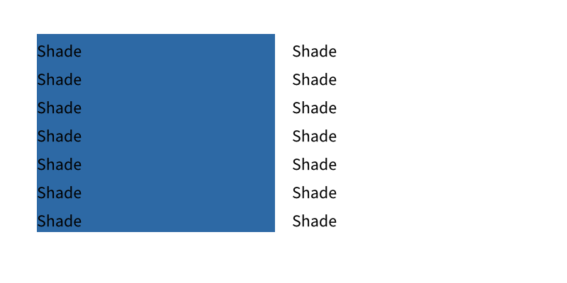 |
| partial-3.png |  | 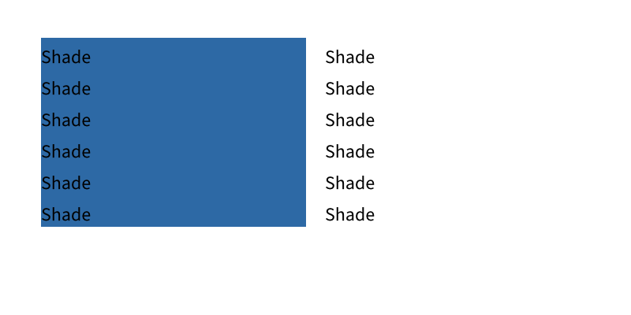 |
| spacing-1.png | 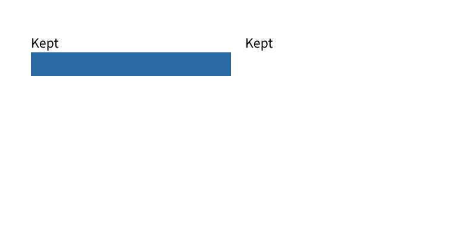 |  |
| spacing-2.png | 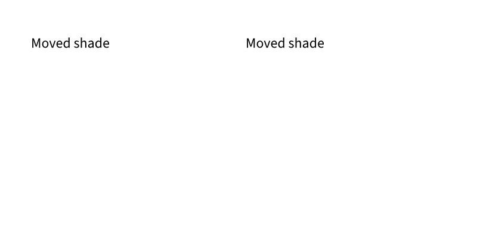 | 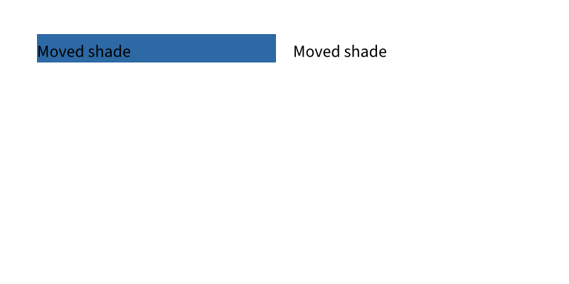 |
| widow-1.png | 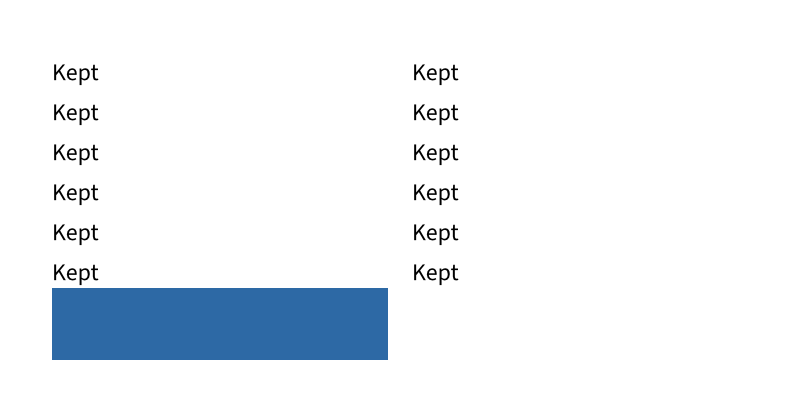 | 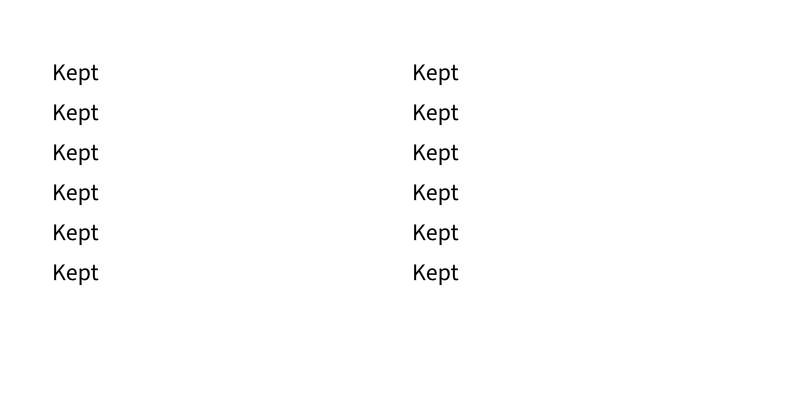 |
| widow-2.png |  | 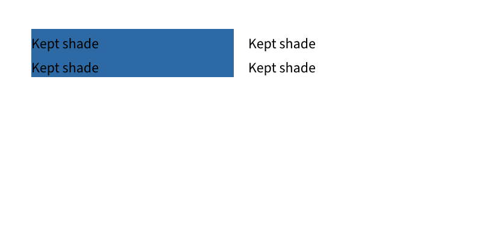 |
