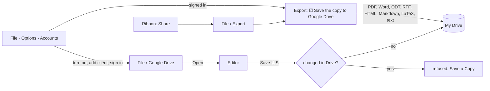

# Google Drive

WordCraft opens documents from Google Drive and saves them back without a sync client: the Google
Drive desktop app isn't needed. Google Drive is **off** until you turn it on in **File › Options ›
Accounts**, so File › Google Drive appears only for people who use it.

Then go to **File › Google Drive**, sign in with Google, pick a document and click **Open**. Save
then sends your changes back to the same file in Drive. You can also save any document to My Drive.



- **Export to Drive.** Once signed in, File › Export (also the ribbon's **Share** button) offers
  **Save the copy to Google Drive**: the chosen format goes to My Drive as a new file, named after
  the document, instead of a folder on this computer. The document itself doesn't change.

- **Formats.** The list shows Word (`.docx`), OpenDocument (`.odt`), RTF and Google Docs files.
  A Google Doc opens as a Word copy (Drive exports it as `.docx`). Saving it adds a new `.docx`
  file beside the original, so the Google Doc itself is never overwritten.
- **Conflicts.** Before saving, WordCraft checks the file's Drive version. If the file changed
  since you opened it (someone edited it in Drive, or another device saved it), nothing is
  overwritten. The save is refused, and **Save a Copy** saves your version as a new file.
  Drive v3 has no conditional update, so a change landing in the fraction of a second between
  that check and the upload isn't caught.
- **No local file.** A document opened from Drive has no path on disk. It isn't added to
  the recent files, and File › Save never writes it beside the app. Save As still saves a local
  copy wherever you choose. Local recovery copies work as for any unsaved document.
- **Desktop only.** The web build answers that Drive needs the desktop app.

## Set up: your own OAuth client

**Quickest way:** File › Options › Accounts › **Guided setup with Google Cloud**. It links straight
to each Google Cloud console page below. After you click **Download JSON** on the new client,
**Import downloaded file** reads the newest `client_secret_….json` in your Downloads folder, fills
in the registration and deletes the download (it holds the secret). Google offers no API for an
app to create a desktop OAuth client itself, so the console steps stay manual.

The same steps by hand:

WordCraft has no Google client of its own built in. Each person, or their organisation, uses
their own Google Cloud project, so sign-in never goes through a WordCraft server.

1. In the [Google Cloud console](https://console.cloud.google.com/), create a project (or
   choose one) and enable the **Google Drive API**.
2. Set up the **OAuth consent screen** (Google Auth Platform › Branding / Audience). For
   yourself: user type *External*, publishing status *Testing*, and add your own Google
   account under **Test users**.
3. Under **Clients**, create an OAuth client ID of type **Desktop app**, then download its JSON.
4. In WordCraft, go to **File › Options › Accounts** and tick **Use Google Drive**. Under
   **1 App registration**, enter the client ID and secret from that JSON and click **Save
   registration**. Under **2 Your Google account**, click **Sign in with Google**.
   That writes `google-drive.json` (owner-only) for you. Or save the JSON yourself as
   `google-drive.json` in WordCraft's profile folder:
   - macOS: `~/Library/Application Support/WordCraft/`
   - Windows: `%APPDATA%\WordCraft\`
   - Linux and BSD: `$XDG_CONFIG_HOME/wordcraft/` (usually `~/.config/wordcraft/`)
   - or the folder named by `WORDCRAFT_PROFILE_DIR`
5. If you wrote the file yourself, turn Google Drive on in File › Options › Accounts, then go to
   File › Google Drive (click **Try again** if the page was already open) and **Sign in with Google**.

The file can also be written by hand:

```json
{ "client_id": "1234-abc.apps.googleusercontent.com", "client_secret": "…", "scope": "drive" }
```

`scope` is `"drive"` (the default: list and open any document in your Drive) or `"file"` (Drive's
`drive.file` scope: only files WordCraft created). With `"file"`, Drive documents made elsewhere
don't appear in the list.
`WORDCRAFT_GOOGLE_CLIENT_ID` and `WORDCRAFT_GOOGLE_CLIENT_SECRET` in the environment take
precedence over the file.

Google documents the secret of a Desktop-app client as not confidential. Keep it out of
repositories anyway: it identifies your project.

## How sign-in works

### Why a client ID and secret *and* a Google sign-in?

You need both; one doesn't replace the other.

| | App registration (client ID and secret) | Google sign-in |
|---|---|---|
| Says | *which app* is asking | *who you are*, and that you allow this app |
| Who sets it up | once per person or organisation, in their Google Cloud project | each person, in the browser |
| Secret? | no: Google treats a desktop app's secret as not confidential | your password and MFA stay with Google |

Google lets only registered apps reach Drive. WordCraft has no registration of its own built in:
there's no WordCraft server between you and Google, and no single project that controls (or can
cut off) everyone's access or shares one API quota. So each person, or an organisation's admin
for everyone, registers once; after that it's an ordinary Google sign-in.

Your sign-in, including 2-Step Verification (MFA), passkeys, security keys and Workspace SSO,
happens on Google's page and never passes through WordCraft.

WordCraft follows Google's flow for installed apps:

1. It listens on `127.0.0.1` on a free port.
2. It opens Google's consent page in your browser, with a PKCE challenge (RFC 7636) and a random
   `state`.
3. Google redirects the browser to that port with a one-time code. WordCraft checks `state`
   and exchanges the code for tokens.

There is no embedded browser, and WordCraft never sees your Google password. The **refresh token** is kept in the system
keychain: Keychain on macOS, Credential Manager on Windows, Secret Service on Linux and the BSDs.
It is never written to a file. If no keychain is available, sign-in lasts until you quit.
**Sign out** revokes the token at Google and removes it from the keychain. A token revoked
elsewhere (from your Google account's security page, say) signs WordCraft out the next time it
calls Drive.

All network calls run on a background thread, never while you type.

## Commands

These are app commands. They work through the control channel and MCP bridged to the app, not
headless.

| Command | What it does |
|---|---|
| `ui.drive.enable` | `{"value"?: bool}`: turns Google Drive on or off (File › Options › Accounts); off by default. Every other command except `status` says how to turn it on |
| `ui.drive.importClient` | `{"path"?: string, "remove"?: bool}`: imports a client JSON downloaded from Google Cloud console; without `path`, the newest `client_secret_*.json` in Downloads, deleted after import |
| `ui.drive.client` | `{"clientId": string, "clientSecret"?: string}`: writes `google-drive.json` and reads it again |
| `ui.drive.export` | `{"format": "pdf"\|"docx"\|"odt"\|"ott"\|"fodt"\|"rtf"\|"html"\|"md"\|"tex"\|"txt"}`: a copy as a new file in My Drive |
| `ui.drive.status` | `{enabled, available, signedIn, busy, error, files, morePages, document}`; `document` is the active document's Drive file, if any |
| `ui.drive.start` | Reads the OAuth client and the keychain (the page does this when it opens) |
| `ui.drive.reload` | Reads `google-drive.json` again |
| `ui.drive.signIn` | Opens the consent page in the browser and waits up to 5 minutes |
| `ui.drive.cancel` | Stops waiting for the browser |
| `ui.drive.signOut` | Revokes and forgets the sign-in |
| `ui.drive.list` | `{"search"?: string, "more"?: bool}`: documents, newest first, 100 at a time |
| `ui.drive.open` | `{"id": string}`: opens a file from the list |
| `ui.drive.save` | `{"name"?: string, "copy"?: bool}`: back to the file it came from; with `name` or `copy`, a new file in My Drive |

Each command except `status` returns at once with `{"started": …}`. Read `ui.drive.status` for
the result. `file.save` without a `path` on a document from Drive runs `ui.drive.save`.

## Code

- `crates/gdrive` (`wordcraft-gdrive`, standalone): OAuth (`oauth.rs`, `pkce.rs`,
  `loopback.rs`), Drive v3 (`drive.rs`), keychain (`store.rs`, the `keyring` crate,
  MIT OR Apache-2.0), and an HTTP seam (`http.rs`, `ureq` with rustls). Tests use a scripted
  transport and an in-memory store. They never reach the network or the keychain.
- `crates/ui-egui/src/gdrive.rs`: the worker thread, the commands and the page. It runs only when
  the desktop app sets `Services::drive_profile`.
