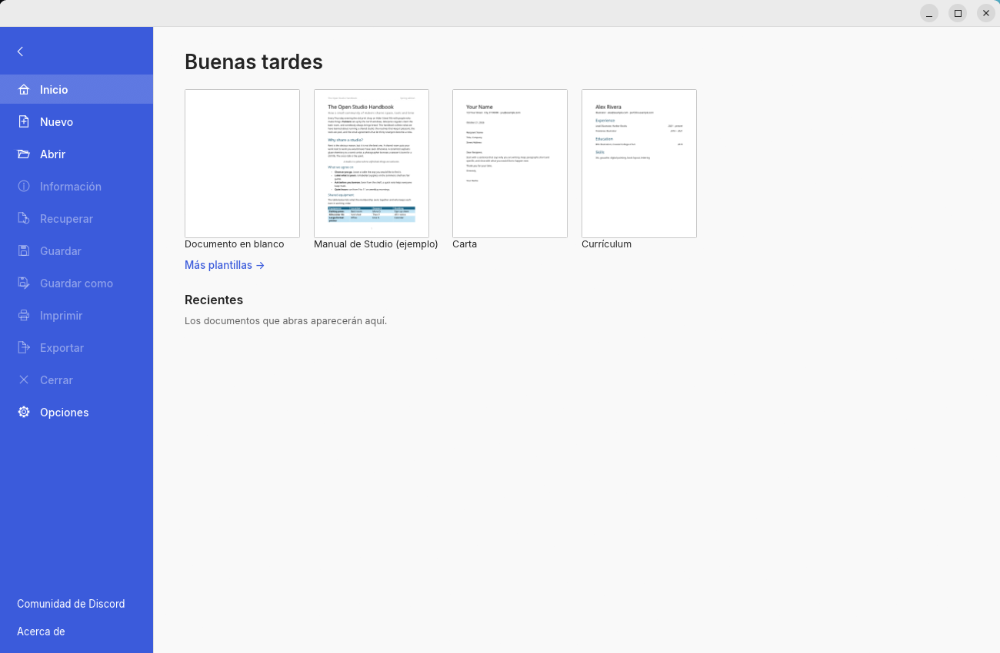
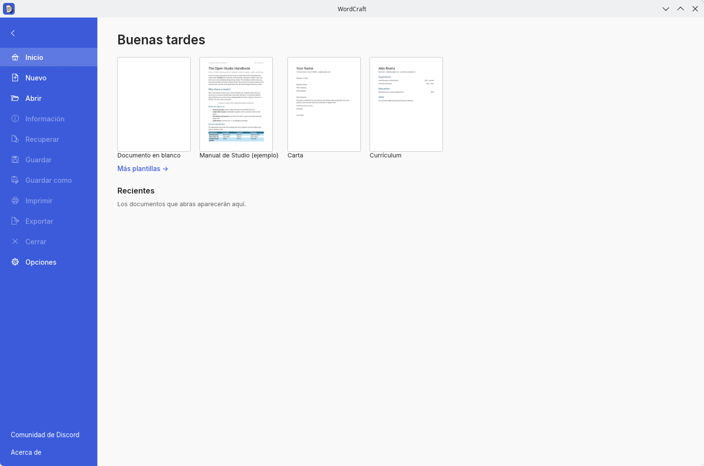

# WordCraft window-controls review evidence

Captured on 21 October 2026 from a native debug build based on `3f86112f1dcdd8c981d52d324cd8505f2f5b5b67`. The screenshots contain only WordCraft, with generated demo content or an empty home screen. No user documents or desktop content are included. The WordCraft build includes the Cargo-generated lockfile repair for tiny-skia-path 0.11.4.

## GNOME / Wayland

GNOME Shell 51.1 / Mutter 51.0. One set of font-free Adwaita minimize, maximize/restore and close buttons is visible.

## KDE / X11

KWin 6.8.0 supplies the existing Breeze frame. The application uses X11 through XWayland, hosted by an isolated KWin Wayland compositor; this is not a full Plasma Xorg session. There is no additional client caption bar.

## Interaction checks

The same binary also ran in an isolated GNOME Shell 51.1 / Mutter 51.1 package runtime. Pointer events were confined to that private compositor. The native caption buttons maximized, restored and minimized the window; it was unminimized through the compositor, dragged by its title bar, resized by dragging the lower-right border, and closed with the native close button. The clean test process exited with status 0. The interaction run used the empty home screen.

`validation.json` records the tested source, binary hash, changed resize geometry and compositor versions. The screenshots are from the installed GNOME 51.1/Mutter 51.0 session and the KWin session; the interaction checks use the separate GNOME 51.1/Mutter 51.1 runtime. Native Windows/macOS and a complete Plasma desktop were not run.

## Repository gate

The native build accepts `--locked --offline` after Cargo regenerates the missing tiny-skia-path 0.11.4 entry. Formatting, workspace/all-target clippy, asset attribution and dependency layers pass. The full workspace test gate stops at `fontdb::tests::a_thai_run_with_latin_falls_back_to_one_face` because this machine has no installed face covering that run. The exact test also fails on an unmodified archive of upstream parent `9b4b948c6ecf29401e01ad58626d3c1983b83770`. No font implementation or test is changed or skipped by this PR.
